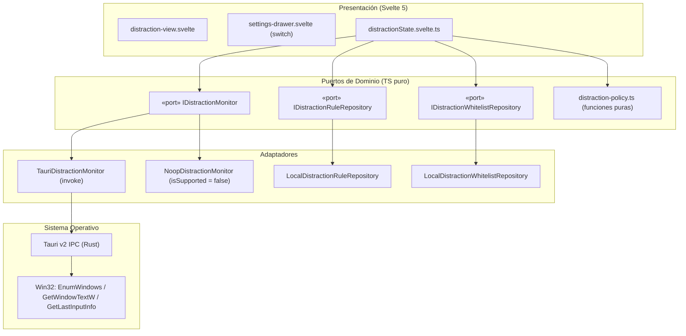
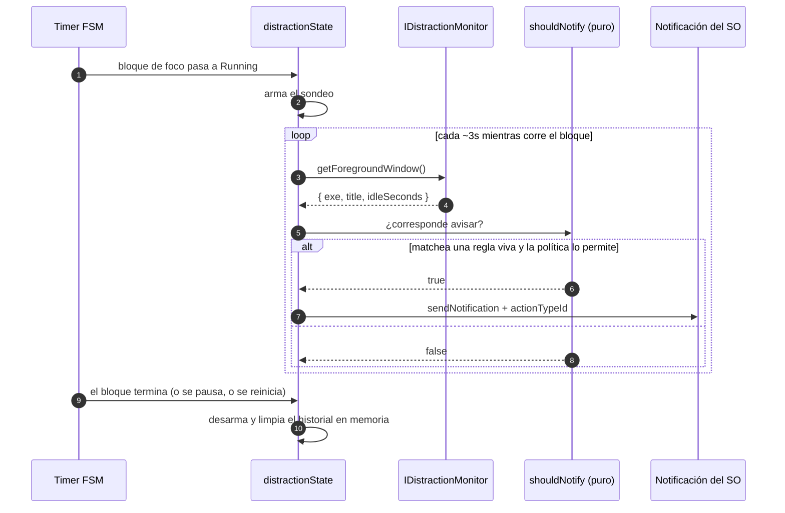

# Especificación Técnica: Detector de Dispersión Ligero (Milestone 5, P3)

> Documento de diseño técnico, contratos de arquitectura hexagonal y especificación de interfaz para el Detector de Dispersión de Pomody en Windows Desktop (Tauri v2).
>
> El **por qué** de cada decisión está en [`decisions.md`](./decisions.md). Este documento define **qué** se construye y **cómo** se integra.
>
> Milestone 5, P3 del [`roadmap.md`](../../roadmap.md). Precedentes documentales: [`mini-player/spec.md`](../mini-player/spec.md) y [`tray/decisions.md`](../tray/decisions.md).

---

## 1. Contexto y Objetivos

El **Detector de Dispersión Ligero** responde al primer ítem del Milestone 5: dar contención activa cuando el usuario ya declaró que algo lo saca del foco, sin convertirse él mismo en la distracción.

- **Qué es**: un recordatorio suave, opt-in y **declarativo**, que se dispara únicamente sobre las ventanas que el usuario marcó como distractivas, y sólo mientras corre un bloque de foco.
- **Qué no es**: no es un analizador de pantalla, no infiere distracciones, no mide productividad, no persiste observaciones y no existe en Web.
- **Filosofía**: la app no juzga. El usuario declara, la app recuerda. Cualquier lista de procesos pre-cargada o heurística de "app de distracción" fue **descartada explícitamente** (ver [`decisions.md`](./decisions.md) §4).
- **Aislamiento Hexagonal**: cero acoplamiento a APIs nativas en `domain/` ni en `components/`. Todo el juicio lógico vive en TypeScript puro y testeable; Rust sólo responde "qué ventana está adelante" y "mostrá un aviso".
- **Paridad Web/Desktop**: en Web el puerto se resuelve con `NoopDistractionMonitor` y **la UI del detector no se renderiza** (ni switch, ni vista, ni toggle muerto). La SPA compila y opera igual.

---

## 2. Principios de Diseño

| #   | Principio                                    | Consecuencia concreta                                                                                                         |
| --- | -------------------------------------------- | ----------------------------------------------------------------------------------------------------------------------------- |
| P1  | **Declaración pura, cero inferencia**        | Una regla existe sólo porque el usuario la creó. Sin semilla, sin lista de "apps conocidas", sin heurísticas de título.       |
| P2  | **Se persisten reglas, nunca observaciones** | Los títulos de ventana viven en memoria y se descartan. Nunca hay historial de lo que viste.                                  |
| P3  | **Armado acotado al foco**                   | El detector sólo corre con un bloque de foco en `Running`. Nunca en descanso, nunca en la bandeja al pedo.                    |
| P4  | **Contención, no configuración**             | El Zen oculta configuración durante el bloque; esto es la feature que el usuario encendió a propósito, así que no se esconde. |
| P5  | **Mínima superficie nativa**                 | Un comando de sondeo, sin hilo propio, sin canal de eventos Rust→frontend, sin ventanas secundarias.                          |

---

## 3. Arquitectura de Dominio y Puertos



### 3.1. Puerto del monitor (`src/lib/domain/ports/distraction-monitor.port.ts`)

```typescript
export interface OpenWindow {
	readonly exe: string;
	readonly title: string;
}

export interface WindowObservation extends OpenWindow {
	/** Segundos desde el último input del usuario (en toda la máquina). */
	readonly idleSeconds: number;
}

export interface IDistractionMonitor {
	/** Verdadero sólo si la plataforma puede leer ventanas de otros procesos. */
	readonly isSupported: boolean;

	/** Ventana en primer plano, o `null` en Web. */
	getForegroundWindow(): Promise<WindowObservation | null>;

	/** Ventanas de nivel superior con título, para el picker de declaración. */
	listOpenWindows(): Promise<readonly OpenWindow[]>;
}
```

`listOpenWindows()` es una lectura efímera de UI: su resultado no se persiste, no se cachea en storage y se descarta al cerrar el picker.

### 3.2. Puertos de persistencia (`src/lib/domain/ports/distraction-repository.port.ts`)

```typescript
export interface IDistractionRuleRepository {
	getAll(): Promise<readonly DistractionRule[]>;
	save(rule: DistractionRule): Promise<void>;
	delete(ruleId: string): Promise<void>;
	clearAll(): Promise<void>;
}

export interface IDistractionWhitelistRepository {
	/** Reglas silenciadas para la fecha local indicada (`YYYY-MM-DD`). */
	getSilenced(dateKey: string): Promise<readonly string[]>;
	silence(ruleId: string, dateKey: string): Promise<void>;
	/** Levanta el silencio de una sola regla para esa fecha (§6.4). */
	unsilence(ruleId: string, dateKey: string): Promise<void>;
	clearAll(): Promise<void>;
}
```

### 3.3. Entidad y matcheo (`src/lib/domain/distraction/distraction-rule.entity.ts`)

```typescript
export interface DistractionRule {
	readonly id: string;
	/** Ejecutable normalizado: minúsculas, sin ruta ni extensión duplicada (`chrome`, `steam`). */
	readonly exe: string;
	/** Substring case-insensitive del título. Ausente = toda la aplicación. */
	readonly titlePattern?: string;
	readonly createdAt: number;
}

export function normalizeExe(rawExecutablePath: string): string;

export function matchesRule(rule: DistractionRule, observation: OpenWindow): boolean;
```

Reglas de matcheo, en orden:

1. `rule.exe` debe ser igual a `normalizeExe(observation.exe)`.
2. Si `rule.titlePattern` está ausente, la regla matchea cualquier ventana de esa aplicación.
3. Si está presente, se compara como **substring, case-insensitive** contra `observation.title`.
4. `titlePattern` vacío o sólo espacios se normaliza a ausente (toda la app), nunca a cadena vacía que jamás matchea.

### 3.4. Política de cadencia (`src/lib/domain/distraction/distraction-policy.ts`)

```typescript
export interface NotifyPolicy {
	/** Minutos mínimos entre dos avisos de la misma regla dentro del bloque. */
	readonly intervalMinutes: number;
	/** Si el usuario no dio input en estos segundos, no se avisa nada. */
	readonly idleGuardSeconds: number;
}

export const DEFAULT_NOTIFY_POLICY: NotifyPolicy = {
	intervalMinutes: 5,
	idleGuardSeconds: 300
};

export interface NoticeFired {
	readonly ruleId: string;
	readonly firedAt: number;
}

export function shouldNotify(input: {
	readonly ruleId: string;
	readonly observation: WindowObservation;
	readonly firedThisBlock: readonly NoticeFired[];
	readonly now: number;
	readonly policy?: NotifyPolicy;
}): boolean;
```

`shouldNotify` es una **función pura**: recibe el historial del bloque en curso, el momento actual y la política, y devuelve sí/no. No conoce Tauri, ni el DOM, ni el storage. Todos los tests de cadencia corren en el proyecto `server` sin abrir un navegador.

---

## 4. Ciclo de Detección



Decisiones de borde, explícitas:

- **El bloque en curso se inmuta**: el historial de avisos vive en memoria y se descarta al terminar el bloque.
- **Cambiar la regla aplica ya**: crear o borrar una regla durante un bloque surte efecto inmediato; no hay nada temporal que preservar (a diferencia de las duraciones del plan, ver [`tasks-and-planning.md`](../tasks-and-planning.md) §4).
- **Apagar el switch desarma al instante** y no dispara nada retroactivo al volver a encenderlo.
- **Pomody nunca se autodetecta**: con la app en primer plano la ventana observada es Pomody, que no puede ser una regla del usuario.

---

## 5. Aviso: Notificación del SO con Tres Acciones

| Acción (id interno) | Etiqueta    | Efecto                                               |
| ------------------- | ----------- | ---------------------------------------------------- |
| `ack`               | _"Gracias"_ | Cierra el aviso. **No agrega nada a ninguna lista.** |
| `silence_day`       | _"Hoy no"_  | Silencia **esa regla** hasta el cambio de día local. |
| `silence_permanent` | _"Nunca"_   | Silencia **esa regla** de forma permanente.          |

- **El diálogo es el toast.** No existe diálogo in-app, ni banderín, ni estado "pendiente de clasificar". Si el toast se desvanece sin respuesta, se interpreta como `ack`.
- **"Nunca" da de baja la regla** del catálogo (`IDistractionRuleRepository.delete`): dejar de existir es lo que la vuelve permanentemente silenciada, sin una cuarta clave de storage ni un flag nuevo en la entidad. La lista de reglas es la única fuente de verdad de lo que puede disparar, así que tras "Nunca" la regla deja de aparecer en la vista del §6. "Hoy no", en cambio, silencia sin borrar y se puede levantar con `unsilence` mientras dure el día.
- **Título y cuerpo** se construyen desde el frontend (por lo tanto pasan por Paraglide/i18n) y nombran la ventana observada de forma efímera.
- **Capacidad requerida**: `notification:default` en `src-tauri/capabilities/default.json`. Los comandos propios de la app **no** requieren entrada de capability (verificado en la doc de Tauri v2).
- **Registro del tipo de acción**: `register_action_types` + `action_type_id` + `on_action`. Sin un handler registrado o un listener `onAction` en JS, **los botones no se muestran**.
- **Degradación documentada**: si Windows no renderiza los botones del toast, el aviso queda como faro y la única vía de declarar reglas es la vista del §6. La feature sigue funcionando, con más fricción. Esto se verifica en la tabla del §12 y **no** reabre el diseño.
- **Etiquetas de los botones**: son las tres palabras del tipo de acción. Si el registro sólo está disponible desde Rust, quedan en inglés fijo por la misma razón que el menú de la bandeja (Rust no lee `localStorage`); ver deuda en [`decisions.md`](./decisions.md) §6.

---

## 6. Vista "Distracciones" (tercer tab de navegación)

- `NavigationTab` pasa de `'timer' | 'planning'` a incluir un tercer valor real. **La pestaña "Métricas" sigue deshabilitada**: pertenece al Milestone 6 y su desbloqueo es un ítem propio de ese hito.
- La vista es el hogar de la **lista de reglas** y de las dos listas de silencio. El **switch global vive en el drawer de Settings**, junto a Revitalización, replicando el precedente del catálogo de descansos (CRUD en la vista, booleano en Settings).

Contenido:

1. **Alta de regla por picker**: desplegable de ventanas abiertas (`listOpenWindows()`), mostrando `título — exe`. Al elegir, se prellenan `exe` y `titlePattern` (con el título vivo) y ambos quedan editables. El desplegable es el `Select` de shadcn-svelte.
2. **Escape manual**: campos de texto para `exe` y `titlePattern`, obligatorios para lo que el picker no puede enumerar (ventanas sin título, procesos elevados). Si el picker no enumeró nada, el desplegable no se renderiza y queda el texto que manda a los campos manuales.
3. **Lista de reglas**: alta, edición y baja, con el patrón visible. La baja se confirma reusando `break-confirm-dialog.svelte` (`decisions.md` §3.1).
4. **Lista de silencios de hoy**: las reglas silenciadas por día, con la opción de levantar el silencio. La sección no se renderiza cuando no hay ninguna.
5. **Estado vacío**: explicación corta de para qué sirve, con el switch apagado por defecto.

---

## 7. Persistencia

Siguiendo el patrón de `local-break-activity-repository.ts` (envelope versionado + validador con fallback):

| Clave                          | Forma                                                            | Contenido          |
| ------------------------------ | ---------------------------------------------------------------- | ------------------ |
| `pomody:distraction-rules`     | `{ version: 1, rules: DistractionRule[] }`                       | Reglas declaradas. |
| `pomody:distraction-whitelist` | `{ version: 1, silencedUntil: 'YYYY-MM-DD', ruleIds: string[] }` | Silencios del día. |
| `pomody:settings` (existente)  | `{ ..., distractionDetectorEnabled: boolean }`                   | Switch global.     |

- **Purga perezosa**: al leer, si `silencedUntil` no es la fecha local de hoy, la lista se ignora y se limpia. Sin timers, sin escrituras periódicas.
- **Dato inválido o corrupto** → fallback al default y no bloquea el arranque, igual que el resto de los repositorios locales.

---

## 8. Puente nativo (Rust / Tauri)

Dos comandos nuevos, registrados en `src-tauri/src/lib.rs`:

```rust
#[tauri::command]
fn active_window() -> Option<WindowInfo>;   // exe + title + idle_seconds

#[tauri::command]
fn open_windows() -> Vec<WindowInfo>;       // picker: sólo ventanas visibles con título
```

Notas de implementación, todas verificables en revisión:

- **Son-`invoke`, no eventos**: el frontend sondea y Rust responde. Cero hilos propios, cero canal de eventos Rust→frontend — exactamente el plumbing que [`tray/decisions.md`](../tray/decisions.md) §4 rechazó construir.
- **API de Win32**: `GetForegroundWindow`, `GetWindowTextW`, `GetWindowThreadProcessId`, `QueryFullProcessImageNameW`, `EnumWindows`, `IsWindowVisible`, `GetLastInputInfo`. Se descartan la ventana propia de Pomody, las ventanas sin título y las invisibles.
- **Procesos elevados**: si la app observada corre como administrador y Pomody no, el nombre del ejecutable puede no ser legible. Se omiten del picker; no es un defecto a corregir.
- **Regla 8 — `Cargo.lock`**: agregar `windows-sys` **toca el lock**. Primer paso del slice 3: medir con `cargo add` sobre una copia desechable (`cargo update`, `cargo generate-lockfile` y borrar el lock están prohibidos). Si la familia Tauri se mueve, se para y se reporta.
- **Regla 9 — verificación del desktop**: `desktop-ci.yml` valida que compile y que los permisos sean válidos; **no** valida comportamiento. Local nunca se corre `pnpm tauri:build`.
- **Requiere Rust ≥ 1.90** para `tauri 2.12` y `tauri-plugin-notification ≥ 2.6.0` (slice 5).

---

## 9. Internacionalización

Claves nuevas, en `messages/es.json` y `messages/en.json` (dominio emite códigos, presentación resuelve). La lista es la que quedó implementada en el slice 5.4: las cinco primeras familias son las del diseño y las dos últimas son las que el markup del §6 necesita y el diseño no había enumerado (nombres accesibles, marcadores y el escape manual).

- **Navegación**: `header_nav_distractions`.
- **Settings**: `settings_section_distraction`, `settings_section_distraction_description`, `settings_distraction_detector`, `settings_distraction_detector_aria`.
- **Estado vacío y listas**: `distraction_view_empty_title`, `distraction_view_empty_description`, `distraction_rules_heading`, `distraction_silenced_heading`, `distraction_silenced_release`, `distraction_silenced_release_aria` (`{exe}`).
- **Alta, edición y baja**: `distraction_rule_add`, `distraction_rule_save`, `distraction_rule_cancel`, `distraction_rule_edit_aria` (`{exe}`), `distraction_rule_delete_aria` (`{exe}`), `distraction_rule_delete_confirm`.
- **Picker y campos manuales**: `distraction_rule_picker_label`, `distraction_rule_picker_placeholder`, `distraction_rule_picker_empty`, `distraction_rule_exe_label`, `distraction_rule_exe_placeholder`, `distraction_rule_title_pattern_label`, `distraction_rule_title_pattern_hint`.
- **Aviso** (las consume el slice 5.5): `distraction_notice_title`, `distraction_notice_body` (`{window}`), `distraction_notice_action_ack`, `distraction_notice_action_silence_day`, `distraction_notice_action_silence_permanent`.

---

## 10. Testing y Fakes

| Capa            | Archivo                                                      | Proyecto Vitest |
| --------------- | ------------------------------------------------------------ | --------------- |
| Entidad/matcheo | `src/lib/domain/distraction/distraction-rule.entity.test.ts` | `server`        |
| Política        | `src/lib/domain/distraction/distraction-policy.test.ts`      | `server`        |
| Adaptadores     | `src/lib/adapters/storage/local-distraction-*.test.ts`       | `server`        |
| Fakes           | `src/testing/fakes/platform/fake-distraction-monitor.ts`     | —               |
| Vista y picker  | `src/lib/components/distraction/*.svelte.test.ts`            | `client`        |
| Estado          | `src/lib/state/distraction.test.ts`                          | `server`        |

Comandos:

```bash
pnpm test:unit      # dominio, estado y storage (rápido, Node)
pnpm test:browser   # vista y picker (Chromium)
pnpm test           # suite completa
```

Casos obligatorios como mínimo: matcheo por exe sin patrón, matcheo por substring de título case-insensitive, patrón vacío tratado como ausente, guarda de inactividad por encima y por debajo del umbral (con `now` inyectado, nunca `Date.now()`), intervalo por regla, reglas independientes entre sí, purga de la whitelist diaria al cambiar de fecha, y adaptador Noop devolviendo `null`/`[]` sin lanzar.

---

## 11. Plan de Ejecución por Slices

Cinco work units, cada una verde por separado y cada una candidata a PR propio:

| Slice                                  | Alcance                          | Entregables principales                                                                                                                                 |
| -------------------------------------- | -------------------------------- | ------------------------------------------------------------------------------------------------------------------------------------------------------- |
| **5.1 Dominio puro y puertos**         | Cero Rust, cero dependencias     | `domain/distraction/*` (entidad, matcheo, política), `domain/ports/distraction-*.port.ts`, tests en `server`.                                           |
| **5.2 Persistencia**                   | Adaptadores locales              | `local-distraction-rule-repository.ts`, `local-distraction-whitelist-repository.ts`, fakes, tests.                                                      |
| **5.3 Puente nativo (Windows)**        | El slice que toca zona protegida | **Medición de la regla 8**, `Cargo.toml`, los dos comandos en `lib.rs`, `TauriDistractionMonitor`, `NoopDistractionMonitor`, selector de plataforma.    |
| **5.4 Vista "Distracciones"**          | UI y navegación                  | Tercer valor en `NavigationTab`, botón en header, `distraction-view.svelte`, picker, listas, claves i18n, tests en `client`.                            |
| **5.5 Notificación y cierre del loop** | El slice que concentra el riesgo | `tauri-plugin-notification`, `notification:default`, registro de acciones, `onAction`, `distractionState.svelte.ts` (sondeo + evaluación), degradación. |

Orden y por qué: 5.1 y 5.2 no tocan nada nativo; 5.3 aísla la única medición sobre `Cargo.lock` para que se revise sola; 5.4 habilita la vía de declaración garantizada; 5.5 cierra el circuito y es el único que exige la tabla de verificación manual del §12.

---

## 12. Criterios de Aceptación (Definition of Done)

- [ ] Cero importaciones de `@tauri-apps/*` fuera de `src/lib/adapters/`.
- [ ] Cero APIs de DOM o Tauri dentro de `src/lib/domain/`.
- [ ] La SPA Web compila y opera sin el switch, sin la vista y sin errores de runtime (`NoopDistractionMonitor`).
- [ ] El switch está en Settings, **apagado por defecto**, y apagarlo desarma el detector al instante.
- [ ] El detector sólo dispara con un bloque de foco `Running`.
- [ ] Una regla nueva por picker o por campos manuales dispara sin reiniciar la app.
- [ ] "Hoy no" silencia esa regla hasta el cambio de día local; "Nunca" la silencia para siempre; "Gracias" no cambia nada.
- [ ] Sin input por más de `idleGuardSeconds` no se emite ningún aviso.
- [ ] Ni un título de ventana queda persistido en storage.
- [ ] `pnpm check`, `pnpm lint`, `pnpm test:unit` y `pnpm test:browser` pasan al 100% sin advertencias.
- [ ] Tabla de verificación manual del §13 ejecutada sobre el `.exe`.

---

## 13. Verificación Manual sobre el `.exe`

Ningún test del repo puede validar comportamiento de ventanas, toasts ni bandeja. La verificación es manual, en Windows:

| #   | Paso                                                                  | Resultado esperado                                                               |
| --- | --------------------------------------------------------------------- | -------------------------------------------------------------------------------- |
| 1   | Activar el switch en Settings                                         | Pide permiso de notificaciones y queda encendido; sin el switch no pasa nada     |
| 2   | Declarar una regla desde el picker                                    | La regla aparece en la lista con su patrón visible                               |
| 3   | Arrancar un bloque de foco y cambiar a la ventana declarada           | Aparece el toast nombrando esa ventana                                           |
| 4   | **Verificar que el toast muestre los tres botones**                   | Con botones → clasificación en el momento; sin botones → degradación documentada |
| 5   | Apretar "Nunca"                                                       | No vuelve a disparar nunca                                                       |
| 6   | Apretar "Hoy no" y volver a la ventana                                | No dispara más hoy; mañana vuelve a estar activa                                 |
| 7   | No tocar nada y quedarse en la ventana                                | A los ~5 min sin input deja de avisar (guarda)                                   |
| 8   | Volver a la ventana después del intervalo                             | Vuelve a disparar                                                                |
| 9   | Minimizar y **ocultar a la bandeja** el Pomody, y distraerse          | ¿Detecta dentro del minuto o el webview estrangula el sondeo? (supuesto a medir) |
| 10  | Dejar la ventana declarada en primer plano y levantarse de la máquina | No hay avalancha de toasts                                                       |
| 11  | Probar con el **portable `.exe`** (sin instalar)                      | El toast aparece igual (AppUserModelID)                                          |
| 12  | Salir desde el menú de la bandeja                                     | No queda nada corriendo                                                          |
